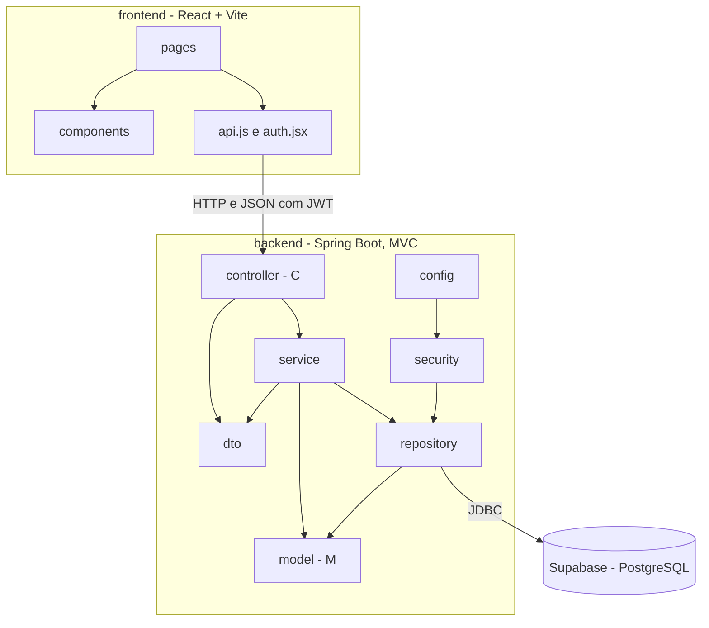

# Diagrama de Pacotes (Visão Lógica)

A camada de visão (V) do MVC é o pacote `frontend`, que consome a API REST; no back-end, `controller` recebe as requisições, `service` concentra as regras de negócio e `model` e `repository` fazem o mapeamento e o acesso aos dados.
